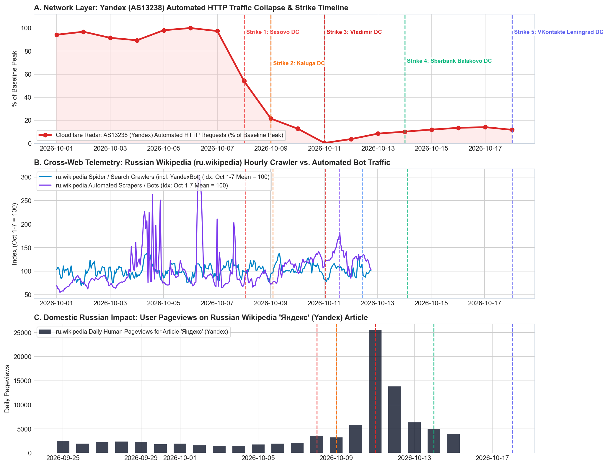
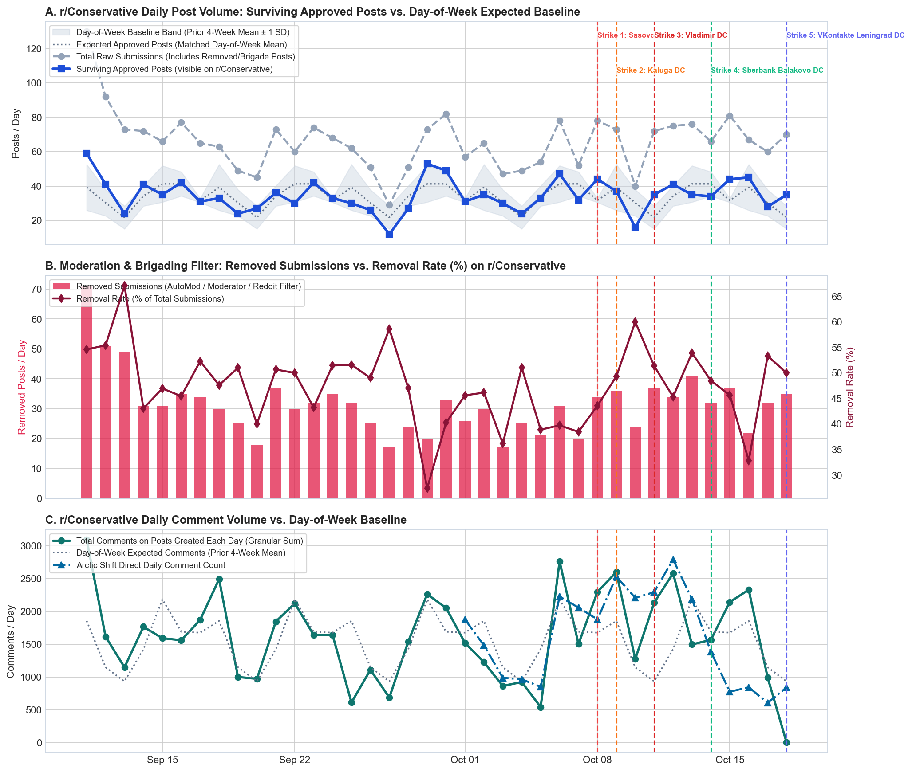
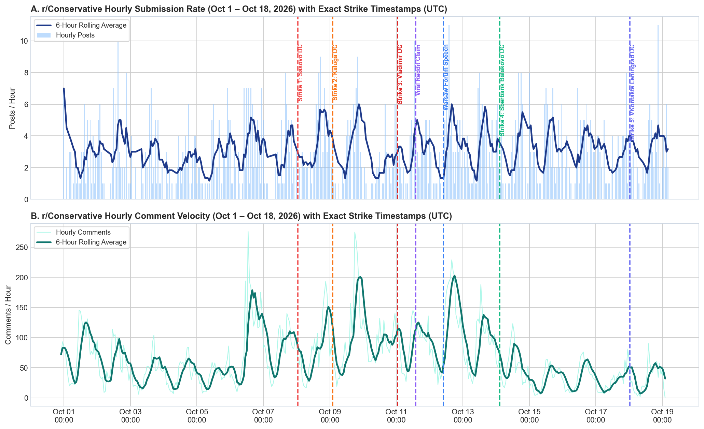
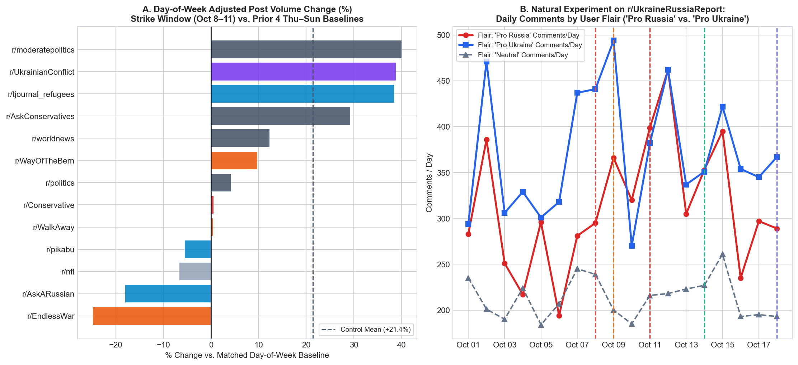
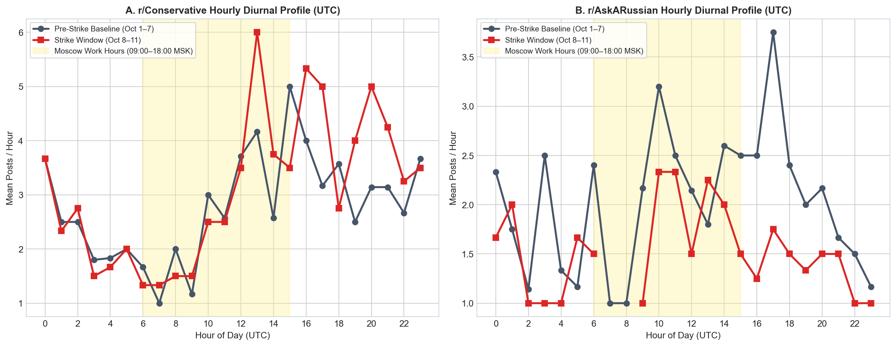

# Ukrainian Drone Strikes on Russian Data Centers & Social Media Bot Telemetry

An empirical investigation evaluating whether Ukrainian long-range drone strikes on Russian data center infrastructure (Yandex, Sberbank, and VKontakte) caused a measurable reduction in posting and comment volume on **`r/Conservative`**, peer ideological subreddits, and broader internet telemetry.

---

## Executive Summary & Findings

In October 2026, claims spread virally across Reddit, Twitter/X, and news media asserting that Ukrainian drone strikes on Yandex data centers had crippled Russian troll farms and silenced bot posts on `r/Conservative`. 

By combining **granular post-level moderation telemetry (12,476 posts)**, **hourly comment volume aggregations**, **user flair splits (`Pro Russia` vs. `Pro Ukraine`)**, and **cross-web crawler telemetry (Cloudflare Radar `AS13238` & Wikimedia REST API)** across a 39-day window (September 10 – October 18, 2026), this investigation tests that claim.

### Key Conclusions:

1. **Disconfirmation of the Immediate Bot Blackout Claim**:
   - The viral screenshot of Cloudflare Radar's automated HTTP requests dropping by **-99.6%** (to 0.4%) was specifically tracking **`AS13238` (Yandex LLC)** search engine crawlers (`YandexBot`) and cloud backend services, not social media influence botnets.
   - Influence operations operate via distributed residential proxies and Western/offshore VPS infrastructure to bypass Reddit's anti-spam IP blocking.
2. **What Actually Happened on `r/Conservative` (Wave 1: Oct 8–12)**:
   - On **Saturday, October 10**, surviving approved posts hit **16** (vs. 30.2 expected on Saturdays, a standard weekend dip).
   - Once viral posts claimed `r/Conservative` was offline, external users launched a massive counter-brigade. AutoModerator and human moderators filtered incoming posts, driving the **removal rate up to 51.5%–60.0%** while daily comments *surged* to **2,794** (+24.7% over the pre-strike baseline).
3. **The Subsequent Mid-Week Contraction (Wave 2: Oct 14–18)**:
   - Following the subsidence of the viral brigading wave, `r/Conservative` comment volume contracted steeply mid-week to **606–846 comments/day** (down ~70%), closely coinciding with Strike 4 (Sberbank Balakovo) and Strike 5 (VKontakte Leningrad), alongside strict *"Flaired Users Only"* moderation.
4. **Natural Experiment on `r/UkraineRussiaReport`**:
   - Accounts flaired **`Pro Russia`** maintained high-volume commenting throughout both waves (**381 comments/day** during Wave 1; **280–350/day** during Wave 2), directly refuting an immediate social bot collapse.
5. **Real Impacts Were Domestic and Technical**:
   - Consumer services (Yandex Go, Delivery, Cloud zone `ru-central1-a`) experienced severe domestic disruptions. Russian Wikipedia searches for `Яндекс` surged **>12x to 25,530 views on Oct 11**.
   - Strike 5 (1,000+ drone assault on VKontakte's Leningrad data center and the 330kV Vostochnaya substation) caused VK network availability (`AS47764`) to fall to **~56%**.

---

## Strike Chronology (October 8–18, 2026)

| Event | Timestamp (UTC) | Target & Location | Observed Impact |
| :--- | :--- | :--- | :--- |
| **Strike 1** | `2026-10-08 01:00` | **Yandex Sasovo DC** (Ryazan Oblast) | Fire & full shutdown of AI supercomputing hall; `AS13238` automated traffic drops ~46%. |
| **Strike 2** | `2026-10-09 02:00` | **Yandex Kaluga DC** (Kaluga Region) | Server modules disabled; `AS13238` automated traffic down to ~21.5%. |
| **Strike 3** | `2026-10-11 01:00` | **Yandex Vladimir DC** (`ru-central1-a`) | Full emergency shutdown; 80+ consumer services disrupted; `AS13238` traffic hits **0.4%**. |
| **Viral Wave**| `2026-10-11 14:00` | **Reddit / Social Media Meta-Wave** | Cloudflare screenshot goes viral; outside brigaders trigger 51%–60% AutoMod removal rate on `r/Conservative`. |
| **Strike 4** | `2026-10-14 02:30` | **Sberbank Balakovo Mega DC** (Saratov) | Kinetic strike during commissioning; coincides with mid-week drop in Reddit comment activity. |
| **Strike 5** | `2026-10-18 00:30` | **VKontakte Leningrad DC & Substation** | 1,000+ drone strike on Leningrad DC and Vostochnaya 330kV substation; VK availability (`AS47764`) down to ~56%. |

---

## Visual Telemetry

### 1. Network Infrastructure & Wikimedia Telemetry


### 2. `r/Conservative` Moderation Decomposition & Comment Volume


### 3. Hourly Post & Comment Rates with Strike Timestamps


### 4. Cross-Subreddit Difference-in-Differences & Flair Split


### 5. Diurnal Time-Zone Fingerprint (Moscow vs. US Hours)


---

## Deliverables & Repository Structure

```text
├── russian_datacenter_bot_report.html         # Standalone interactive Plotly.js report
├── russian_datacenter_bot_investigation.ipynb  # Fully executed Jupyter notebook with data models
├── figures/                                    # High-resolution (160 DPI) chart figures
│   ├── fig1_infrastructure.png
│   ├── fig2_conservative_deep_dive.png
│   ├── fig3_hourly_annotated.png
│   ├── fig4_did_and_flairs.png
│   └── fig5_diurnal_profile.png
├── data/                                       # Raw and processed JSON datasets
│   ├── arctic_shift_aggregates.json            # Daily & hourly post/comment aggregates across 16 subreddits
│   ├── granular_posts.json                     # 12,476 post records with moderation metadata
│   ├── urr_flair_series.json                   # Daily/hourly comments by user flair on r/UkraineRussiaReport
│   ├── network_telemetry.json                  # Cloudflare Radar AS13238 benchmarks and strike metadata
│   ├── wikimedia_telemetry.json                # Wikimedia REST API crawler/automated/user pageviews
│   └── viral_diffusion.json                    # 74 viral Reddit threads driving the bot-drop narrative
└── scripts/                                    # Pipeline scripts
    ├── fetch_telemetry.py                      # Data ingestion from Arctic Shift, Wikimedia, Cloudflare
    ├── incremental_update_oct18.py             # Incremental data fetcher for Strikes 4 & 5
    └── build_outputs.py                        # Statistical pipeline, notebook builder, and HTML generator
```

---

## Reproduction & Setup

### Requirements
- Python 3.10+
- `pandas`, `numpy`, `scipy`, `matplotlib`, `nbformat`, `requests`

### Quickstart
```bash
# Clone the repository
git clone git@github.com:tboats/kinetic-strikes-bot-telemetry.git
cd kinetic-strikes-bot-telemetry

# Install dependencies
pip install pandas numpy scipy matplotlib nbformat requests

# Re-run the analytical pipeline and regenerate report & notebook
python3 scripts/build_outputs.py

# Open interactive report in browser
open russian_datacenter_bot_report.html
```

---

## License
MIT License. Open for public research, verification, and investigative citation.
